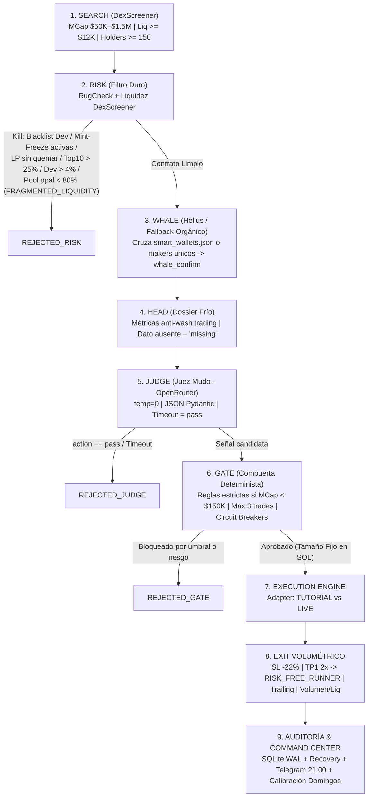
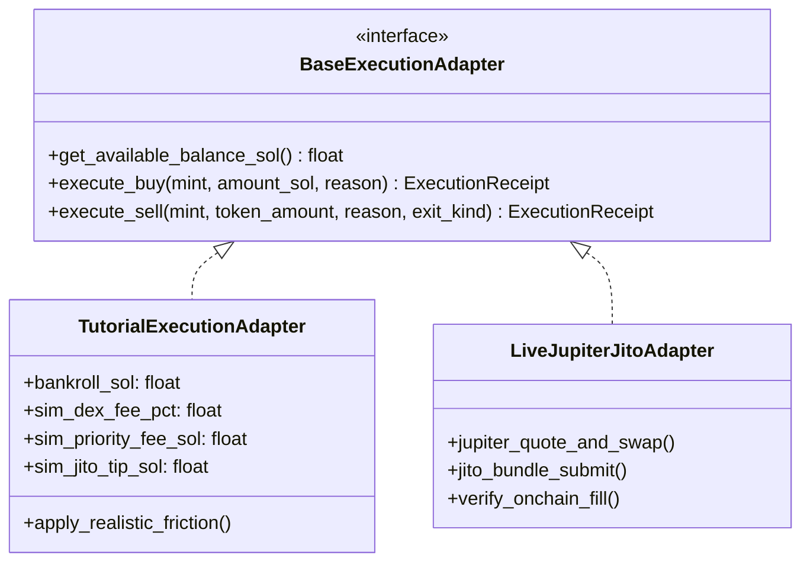
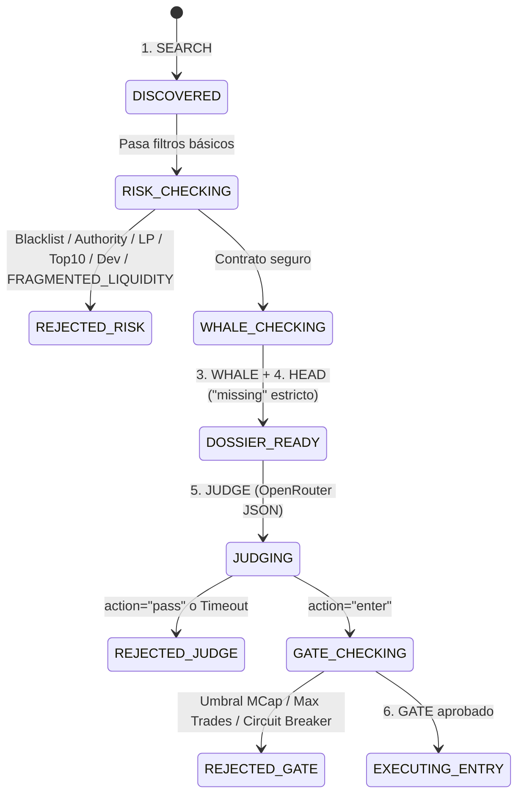
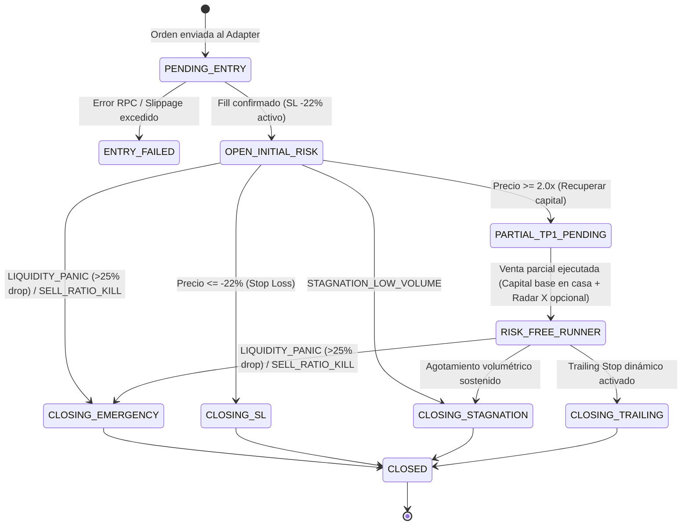

# METEORO TRADER SOLANA — Arquitectura del Sistema

Sistema autónomo multi-agente para detección, auditoría dura de contratos, evaluación probabilística con **Juez Mudo** (cero prosa, JSON estricto), ejecución con patrón adaptador (**Tutorial realista en SOL** vs. **Live con Jupiter + Jito**), salidas volumétricas automáticas y **Command Center visual** en tiempo real.

---

## 1. Principios de Diseño Innegociables

1. **Datos fríos, cero alucinaciones:** En el armado del expediente (`HEAD`), cualquier métrica ausente se registra literalmente como `"missing"`. Está prohibido interpolar o adivinar datos.
2. **Juez Mudo (`JUDGE`):** El LLM opera a `temperature=0` con *Structured Outputs* (Pydantic). Responde únicamente 5 campos cerrados (`organic`, `late`, `exit_risk`, `manipulation_trap`, `action`) con probabilidades. Cero texto libre. Cualquier timeout o error de red equivale automáticamente a `action="pass"`.
3. **Compuerta Determinista (`GATE`):** El tamaño de entrada (`TRADE_SIZE_SOL`) es **fijo**. El Juez decide **SI** un candidato califica para evaluación final, **NUNCA cuánto** capital arriesgar. Los tokens con Market Cap `< $150,000` enfrentan umbrales probabilísticos más estrictos.
4. **El volumen manda sobre la narrativa:** Las salidas automáticas están gobernadas por precio, volumen, presión vendedora y liquidez del pool. La capa opcional de X (Twitter) solo actúa como radar contextual en posiciones libres de riesgo (`RISK_FREE_RUNNER`) o de alto volumen, sin anular jamás un gatillo volumétrico de salida.
5. **Paridad exacta Tutorial / Real:** El pipeline desde `SEARCH` hasta `EXIT` es 100% idéntico en ambos modos; solo cambia el adaptador de ejecución inyectado en el `ExecutionEngine`.

---

## 2. Pipeline Multi-Agente (De Punta a Punta)



### Detalle por Fase del Ciclo

| Fase | Componente | Responsabilidad Crítica |
| :--- | :--- | :--- |
| **1. SEARCH** | `SearchScanner` | Escanea pares en Solana vía DexScreener dentro del rango de Market Cap (`$50K`–`$1.5M`), liquidez `>= $12,000` y `>= 150` holders, deduplicando candidatos recientes. |
| **2. RISK** | `HardRiskFilter` | Auditoría implacable vía RugCheck + pools de DexScreener. Descarta al instante si: deployer en `blacklisted_devs`, `Mint` o `Freeze` authority activas, LP no quemada/bloqueada, Top 10 holders `> 25%`, dev wallet `> 4%`, o el pool principal concentra `< 80%` de la liquidez total (`FRAGMENTED_LIQUIDITY`). |
| **3. WHALE** | `WhaleTracker` | Verifica compras recientes de wallets en `backend/data/smart_wallets.json` vía Helius. Si Helius no está disponible o no hay match directo, evalúa fallback de actividad orgánica fuerte de compradores únicos y etiqueta `whale_confirm`. |
| **4. HEAD** | `ColdDossierBuilder` | Construye un expediente numérico inmutable con métricas anti-wash trading: `volume_5m_usd`, `volume_1h_usd`, `unique_makers_5m`, `vol_to_liquidity_ratio_1h`, `avg_tx_size_5m_usd`. **Regla de Oro:** cualquier campo no verificable vale literalmente `"missing"`. |
| **5. JUDGE** | `MuteJudge` | Invoca modelo rápido en OpenRouter (`temperature=0`, validación estricta Pydantic). Devuelve probabilidades para `organic`, `late`, `exit_risk`, `manipulation_trap` y decisión `action` (`"enter"` / `"pass"`). Sin prosa ni justificaciones. Timeout -> `"pass"`. |
| **6. GATE** | `DeterministicGate` | Reglas deterministas en Python puro: umbrales endurecidos cuando `market_cap_usd < 150_000`, `TRADE_SIZE_SOL` fijo, máximo 3 posiciones abiertas simultáneas, y pausa operativa (*circuit breaker*) si se alcanza pérdida máxima diaria o 3 Stop Loss consecutivos. |
| **7. EXECUTION** | `ExecutionEngine` | Ejecuta órdenes de entrada y salida delegando en `TutorialExecutionAdapter` o `LiveJupiterJitoAdapter` bajo una interfaz común (`BaseExecutionAdapter`). |
| **8. EXIT** | `VolumetricExitManager` | Monitorea posiciones abiertas: SL inicial `-22%`, venta parcial de recuperación de capital en `TP1 (2x)` transicionando a `RISK_FREE_RUNNER`, Trailing Stop dinámico, `STAGNATION_LOW_VOLUME`, `SELL_RATIO_KILL` y `LIQUIDITY_PANIC` (drenaje `> 25%`). Radar opcional de X solo en `RISK_FREE_RUNNER` o alto volumen. |
| **9. AUDIT & RECOVERY** | `AuditAndRecoveryService` | Rehidratación automática de posiciones abiertas desde SQLite al iniciar el servidor, reporte diario por Telegram (21:00) y tabla de calibración semanal del Juez los domingos. |
| **10. COMMAND CENTER** | `FastAPI + React/Vite` | API REST + WebSockets en tiempo real hacia un tablero estilo juego/radar: embudo de fases en vivo, PnL neto en SOL/USD, motivos de descarte, blacklist de devs, radar de X y controles esenciales protegidos por `DASHBOARD_PIN`. |

---

## 3. Patrón Adaptador: `TUTORIAL` vs. `LIVE`

El `ExecutionEngine` desacopla la lógica de trading del transporte de órdenes mediante el patrón **Strategy / Adapter**:



### 3.1 Modo Tutorial Realista (`TRADING_MODE=TUTORIAL`)
No es un *paper trading* ingenuo a precio medio. Descuenta y acredita SOL contra una banca virtual persistida en SQLite (`TUTORIAL_INITIAL_BANKROLL_SOL`), descontando en **cada** operación las fricciones reales de Solana:
- **Fricción fija por transacción (en SOL):** `SIM_PRIORITY_FEE_SOL` (ej. `0.0005 SOL`) + `SIM_JITO_TIP_SOL` (ej. `0.002 SOL`) + fee base de red (`0.000005 SOL`).
- **Comisión DEX porcentual:** `SIM_DEX_FEE_PCT` (ej. `0.25%` sobre nocional).
- **Slippage asimétrico según tipo de orden:**
  - **Compra (`BUY`):** penaliza precio de entrada con `SIM_BUY_SLIPPAGE_PCT` (`1.5%`).
  - **Take Profit / Salida ordenada (`TP` / `TRAILING` / `STAGNATION`):** penaliza precio de salida con `SIM_TP_SLIPPAGE_PCT` (`2.0%`).
  - **Stop Loss / Pánico (`SL` / `SELL_RATIO_KILL` / `LIQUIDITY_PANIC`):** castiga severamente el precio de salida con `SIM_SL_SLIPPAGE_PCT` (`8.0%`), reflejando velas rojas y libros delgados reales en memecoins.
- **Contabilidad:** Registra `gross_sol`, `total_fees_sol`, `slippage_impact_sol`, `net_pnl_sol` y `net_pnl_usd` usando cotización SOL/USD en vivo.

### 3.2 Modo Real (`TRADING_MODE=LIVE`)
Ejecuta exactamente el mismo ciclo, pero requiere superar un **Doble Candado de Seguridad** en configuración (`config.py`):
1. `TRADING_MODE=LIVE`
2. `ENABLE_LIVE_EXECUTION=true`
3. `LIVE_WALLET_PRIVATE_KEY` configurada (wallet caliente dedicada exclusivamente al bot).

Si cualquiera de las tres condiciones falta, el arranque aborta de forma segura (`ConfigurationError`) antes de abrir sockets o escanear tokens. En ejecución real, obtiene ruta óptima en Jupiter v6 y envía transacción/bundle con propina a Jito Block Engine aplicando slippage en `bps` según el motivo de salida.

---

## 4. Máquina de Estados del Token y de la Posición

### 4.1 Ciclo de Vida de Evaluación (Pipeline Funnel)


### 4.2 Ciclo de Vida de la Posición Abierta (`PositionState`)


### 4.3 Recuperación ante Caídas (`Crash Recovery`)
Al arrancar el backend:
1. Antes de habilitar `SearchScanner`, `AuditAndRecoveryService` consulta SQLite buscando posiciones en estados no terminales (`OPEN_INITIAL_RISK`, `PARTIAL_TP1_PENDING`, `RISK_FREE_RUNNER`, `CLOSING_*`).
2. Rehidrata en memoria los objetos de seguimiento (precio de entrada, máximo histórico `peak_price_usd`, liquidez de referencia `baseline_liquidity_usd`, remanente de tokens y estado `RISK_FREE_RUNNER`).
3. Reanuda inmediatamente el bucle de `VolumetricExitManager` sobre dichas posiciones y descuenta esos slots del límite `MAX_CONCURRENT_TRADES=3`.

---

## 5. Estructura de Carpetas del Proyecto

```text
METEORO TRADER/
├── .env.example                 # Plantilla documentada de variables de entorno
├── .gitignore                   # Protección de credenciales, DB y artefactos
├── ARCHITECTURE.md              # Este documento de arquitectura
├── backend/
│   ├── requirements.txt         # Dependencias Python de producción y testing
│   ├── data/
│   │   └── smart_wallets.json   # Wallets whale / smart money auditadas (Fase 3)
│   ├── logs/                    # Logs estructurados rotativos
│   ├── src/
│   │   ├── __init__.py
│   │   └── config.py            # Configuración tipada y candados vía pydantic-settings
│   └── tests/                   # Suite pytest / pytest-asyncio
└── dashboard/                   # Reservado para Fase 5 (React + Vite + Tailwind CSS)
```
